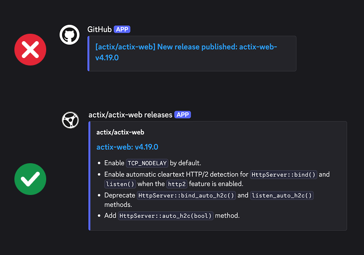

# GitHub release router

Send GitHub release announcements to Discord. The service checks webhook signatures, routes releases by repository and tag, and retries failed deliveries. Each message includes the release title, link, and notes. Long notes are attached as a Markdown file.

No GitHub token, Discord bot, database, or workflow in the source repository is required.

## Deploy with Docker Compose

You need Docker with Compose, OpenSSL, permission to create a Discord webhook, and an HTTPS address that can forward requests to this service. Run the commands below from this project directory.

### 1. Configure a repository

```sh
cp config.example.toml config.toml
mkdir -p secrets
chmod 700 secrets
openssl rand -hex 32 > secrets/github_webhook_secret
```

Edit `config.toml`. Replace **both** instances of `example/app` with your repository's `owner/name`. The default route announces published releases and excludes prereleases.

### 2. Add a Discord webhook

In your target Discord channel, open **Edit Channel → Integrations → Webhooks**. Create a webhook and copy its URL into `secrets/discord_webhook_url`. Use the URL as copied, without a `/github` suffix.

Make both secret files readable by the container's user (UID 10001):

```sh
chmod 644 secrets/github_webhook_secret secrets/discord_webhook_url
```

The `secrets` directory stays accessible only to your host user. The configuration and secrets are excluded from Git and Docker's build context.

### 3. Start the service

```sh
docker compose up --build -d --wait
curl --fail http://127.0.0.1:8080/readyz
docker compose logs -f router
```

The readiness endpoint returns `ready` when the worker is running. Compose binds the port to host loopback. Run **one instance**: the delivery queue, duplicate detection, and rate limits are stored in memory. Restarting clears this state, including pending deliveries.

### 4. Expose the webhook over HTTPS

Configure your reverse proxy to forward to `http://127.0.0.1:8080`. A proxy on the Compose network can use `http://router:8080`. Preserve the request path, body, and GitHub headers. Allow request bodies up to 2 MiB and terminate TLS at the proxy.

### 5. Connect GitHub

In your repository, open **Settings → Webhooks → Add webhook**:

| Setting | Value |
| --- | --- |
| Payload URL | `https://YOUR_HOST/webhooks/github/releases` |
| Content type | `application/json` |
| Secret | Contents of `secrets/github_webhook_secret` |
| SSL verification | Enabled |
| Events | Select individual events, then **Releases** |

GitHub's initial ping must return `200 pong`. Publish a release to send an announcement. Organization webhooks use the same endpoint; list each allowed repository in the source configuration.

## Configuration and operations

- [Configuration](docs/configuration.md): more repositories, channels, secrets, and tag filters.
- [Operations](docs/operations.md): health checks, logs, retries, updates, and recovery.
- [Kubernetes deployment](k8s/README.md): manifests, secrets, and ingress.
- [Development and container publishing](docs/development.md): local commands and CI.

To preview an announcement without credentials or network requests:

```sh
just preview
```

HTTP `202` means the release was accepted into memory. Check service logs for the delivery result. For failed or lost deliveries, use **Redeliver** in GitHub's webhook delivery history. See [delivery and recovery](docs/operations.md#delivery-and-recovery) for the delivery limits.
